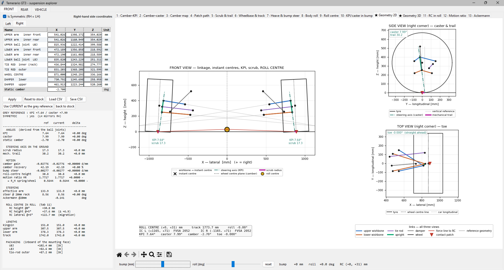
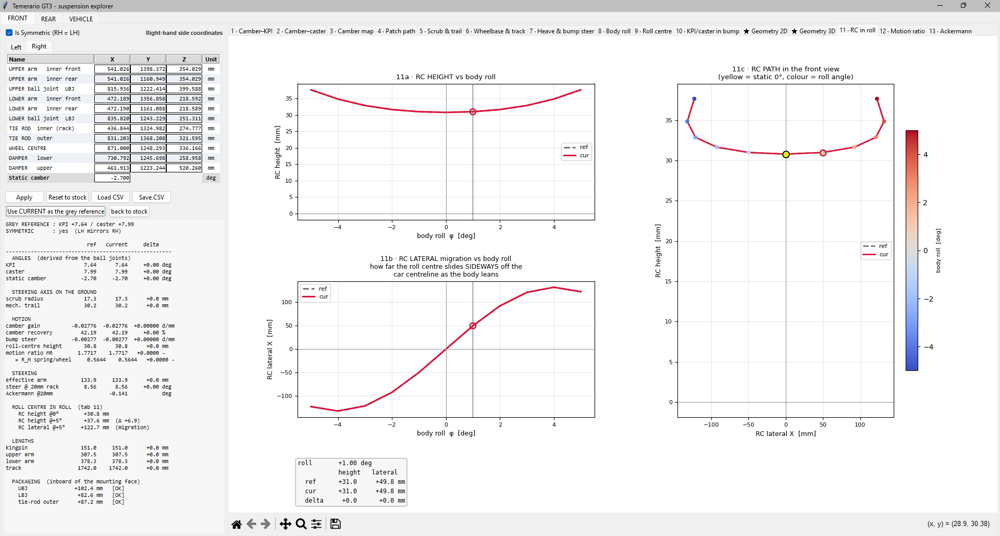
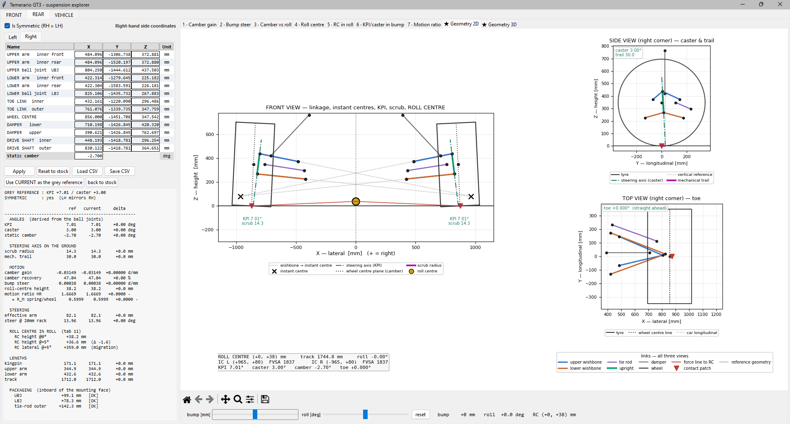
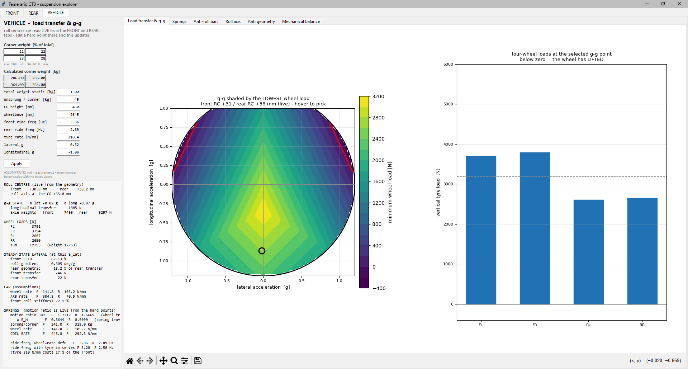
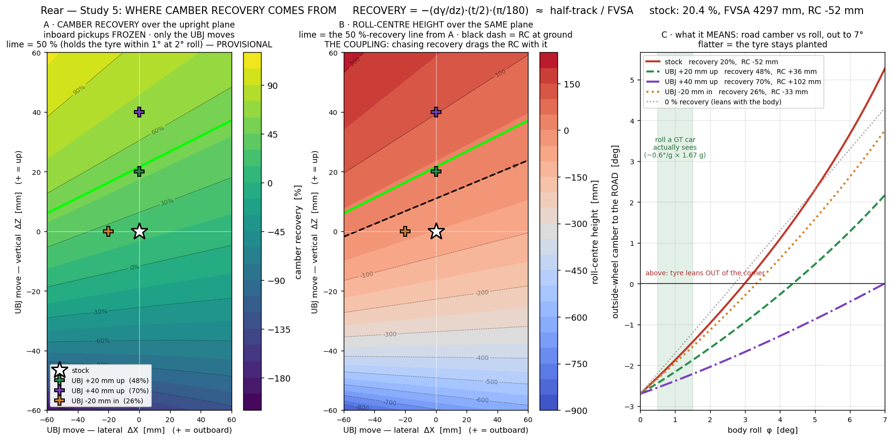

# GT3 suspension kinematics workbench

A desktop tool for designing double-wishbone suspension geometry. Load a set of
hard points, move one, and every derived quantity updates on the real linkage.



The front axle after the redesign. Front view with both linkages, their instant
centres and the roll centre they put at +31 mm; side view with the steering axis
and 30.2 mm of trail; top view with toe. The panel on the left is live: type a
coordinate, press Enter, and every number and curve in the window is resolved
again from the linkage. The grey geometry underneath is whatever you set as the
reference, so a change reads as a difference rather than a new picture.

---

## What it found

Working the front axle and then the rear through the tool moved the starting
geometry to this. Both columns are printed from the two CSV files by
`hardpoints/verify_table.py`; the full table, with the conventions it depends
on, is in [hardpoints/README.md](hardpoints/README.md).

| | starting | redesigned |
|---|---|---|
| front roll centre | 283.6 mm underground | **+30.8 mm** |
| front bump steer | −0.117 °/mm | **−0.003 °/mm** |
| front scrub radius | 144.9 mm | **17.3 mm** |
| rear camber recovery | 20.4 % | **47.0 %** |
| rear roll-centre migration | 847 mm at 1° of roll | **86 mm** |

The last row is the one I would defend. Most of it came from lengthening both
wishbones **along their own lines**, which changes an arm's radius while leaving
its tangent alone: position and first-order motion are untouched, so KPI,
caster, scrub and trail come out bit-identical and only the second-order term,
the migration, moves. On the rear that step by itself is worth 30×, more than
the net figure above, because the later steps traded some of it back for
roll-centre height. `hardpoints/verify_lengthening.py` builds the intermediate
geometry the table cannot show and prints the comparison.



The tab that row comes from. Top left is roll-centre height against body roll,
bottom left is how far the roll centre slides sideways off the centreline, and
right is the path it actually takes in the front view, coloured by roll angle.
The box underneath reads the pair off at a chosen angle: at 1° of roll this
axle moves its roll centre 49.8 mm sideways, while the height barely changes.

Migration is the number a lap does not forgive. Roll-centre height is a static
choice you make once; its lateral movement is what changes the car underneath
the driver mid-corner, and it is invisible in every static readout.

**The starting geometry is not a real GT3.** The hard points are my own Fusion
measurement of a third-party display model, which is why stock KPI comes out at
−5.27°, a value no manufacturer would build. That was useful rather than a
problem: it gave me a car with realistic proportions and poor kinematics, so
every number here is one I had to move myself.

---

## How the corner is solved

It solves in 3D. There is no side-view or front-view instant-centre
construction anywhere in the maths, because those are projections of a 3D
mechanism: the instant centre runs off to infinity for perfectly ordinary
geometry, and the projection of a 3D rigid motion is not itself a rigid planar
motion. The front axle of this car is one of those ordinary cases, twice over.
Its side-view hinge axes are parallel to within 0.001°, which puts the
side-view instant centre at infinity. In front view the two arms sit 0.54°
apart, which puts the swing arm at 13.3 m, and moving the upper inner pickups
1 mm in Z takes that to 9.1 m or 24.9 m depending on the direction. At 2 mm it
is past 200 m. The number is arithmetically correct and useless, which is the
reason none of the derived quantities here are built on it.

---

## Verification, not validation

793 assertions run against the maths. `python software/validate_all.py`.

They check the tool against theory and against itself: closed-form identities,
two independent derivations of the same quantity, symmetry and sign rules,
limiting cases, and agreement between the solved linkage and the drawing-board
construction it should reproduce. Where a published equation exists, the code
derives it from first principles and asserts agreement with the published form,
rather than coding the published form and trusting it.

**None of it is validated against a measured car.** There is no rig data, no
track data and no manufacturer geometry here, so nothing in this repository
shows that these numbers describe a real Temerario GT3. What the suite
establishes is narrower, and worth saying plainly: the kinematics are internally
consistent, and the implementation matches the theory it claims to implement.
The before/after differences are the useful output. The absolute values are the
output of a model.

The assumption that would most change the answers is the tyre. With no measured
load-deflection data the tyre module ships a labelled linear placeholder, and
everything downstream of tyre rate, ride frequency included, inherits it.

---

## How this was built

The engineering is mine. The geometry decisions, the derivations, what to
measure, what to believe and what to discard came from working the problem;
`software/MATHS.md` shows the worked maths behind the front-corner equations.

The code was written with AI assistance (Claude). I specified the physics and
the checks, and it wrote and refactored the Python. Nothing went in on its word:
a result had to agree with a derivation, an independent second route, or a
published equation before it stayed, which is most of why the assertion count is
what it is. Several errors caught that way are written up where they happened,
in `software/config.py`, `software/ackermann.py` and `software/MATHS.md`,
because a sign error that two halves of a project disagree about silently is
more instructive than a clean result.

---

## Install and run

```bash
pip install -r requirements.txt
python software/explorer.py
```

Windows users can double-click `run_tool.bat` instead.

Needs Python 3.10 or later, NumPy, Matplotlib and Tkinter. SciPy is optional:
one check uses it and is skipped if it is missing.

---

## Workflow

**1. Point it at a set of hard points.**

`hardpoints_fusion.csv` in the repository root is what loads on startup. It is
a plain table:

```
Corner,Point,X_mm,Y_mm,Z_mm
FRONT,Upper wishbone - outer (UBJ),815.936,1222.414,399.588
...
```

`X` is lateral and positive outboard, `Y` is longitudinal and positive forward,
`Z` is vertical. The file holds the front-right and rear-right corners; the left
side is their mirror.

A second set is in `hardpoints/`, the geometry this project ended up with after
a front and rear redesign. Load it to see a worked-through result instead of the
starting point.

**2. Pick a page.** Three across the top: FRONT, REAR, VEHICLE.

**3. Edit points on the Hard points tab.** Type a coordinate, press Enter. Every
other tab recalculates. The reference geometry stays drawn underneath so a
change is visible as a difference rather than a new picture.

**4. Read the numbers, not just the curves.** Each corner page carries a text
readout with the static values: KPI, caster, scrub, trail, camber gain, camber
recovery, bump steer, roll-centre height, motion ratio, steering arm.

**5. Save.** Writes a CSV in the same format, so a saved set loads straight back.

---

## The tabs

### FRONT and REAR pages

| tab | what it shows | what moves it |
|---|---|---|
| **Camber–KPI**, **Camber–caster** | camber change against steer angle, one curve per KPI or caster value | the two ball joints |
| **Camber map** | camber over the KPI–caster plane at a chosen steer angle | - |
| **Patch path** | where the contact patch travels as the wheel steers | scrub and trail |
| **Scrub & trail** | both against steer, with the sign convention drawn | sliding the ball joints along the steering axis |
| **Wheelbase & track** | how much each one changes with steer | scrub sets the curvature, trail sets the slope |
| **Heave & bump steer** | toe against wheel travel | the tie rod or toe link, after the instant centre is settled |
| **Body roll** | camber against body roll, which is what the tyre actually sees | camber recovery, i.e. FVSA |
| **Roll centre** | height against wheel travel | common-mode inner pickup height |
| **RC in roll** | the roll centre's lateral migration, usually the number that matters | the ratio of the two arm lengths |
| **KPI/caster in bump** | how the steering axis itself moves through travel | the side-view hinge-axis angles |
| **Motion ratio** | wheel travel over spring travel, through the stroke | where the damper's lower mount sits, and how far the damper leans |
| **Ackermann** | the axle-level percentage on the real steer geometry (front only) | the tie-rod outer, fore and aft |
| **Geometry 2D / 3D** | front, side and top views with the construction lines on them | - |

The rear is the same page with the rack frozen and a toe link in place of the
tie rod, so the same tabs mean the same things:



Rear axle, redesigned. Both instant centres sit at ±965 mm, which is the
1837 mm swing arm behind 47 % camber recovery. Note the static camber reads
−2.7° here rather than the −1.5° the hard-point set is specified at: camber is
a setup input, not a hard point, and the readouts that move with it say so.
Scrub reads 14.3 mm at −2.7° and 7.1 mm at −1.5° on these same points.

### VEHICLE page

| tab | what it shows |
|---|---|
| **Load transfer & g-g** | wheel loads under combined lateral and longitudinal acceleration |
| **Springs** | coil rate from a target ride frequency, motion ratio solved from the linkage, both definitions of ride frequency side by side |
| **Anti-roll bars** | bar and blade rates, the drop-link ratio solved from the geometry, roll-stiffness split |
| **Roll axis** | both roll centres and the axis between them, in side view |
| **Anti geometry** | anti-dive, anti-lift and anti-squat, with what the side-view tilt costs in the front view |
| **Mechanical balance** | lateral load-transfer distribution against spring and bar changes |



The two roll centres on this page are read live from the FRONT and REAR pages,
so moving a wishbone pickup changes the load transfer here. Everything else in
the left-hand column is a typed assumption and the panel labels it as one:
masses, CG height, the ride frequencies the coil rates come from, and the tyre
rate. The g-g map is shaded by the *lowest* of the four wheel loads, so the dark
corners are where a wheel is about to leave the road rather than where grip
runs out, and the bar chart is the four loads at whichever point you pick.

Nothing on this page is measured. It is there to show which way a geometry
change pushes the car, and by roughly how much.

---

## Things worth knowing before you change a number

**Motion ratio is shown the textbook way.** `MR` is wheel travel over spring
travel, so the coil rate is `K_s = K_w · MR²`. Internally the solver works in
the reciprocal, because that is what it produces directly. `software/springs.py`
is the only place the two meet. Mixing them is an error to the fourth power.

**Ride frequency means two different things.** One definition leaves the tyre
out, the other puts it in series with the spring. On a racing car the wheel rate
is roughly half the tyre rate, so the two numbers differ by a lot and the
published target bands belong to only one of them. On this car the front reads
3.86 Hz with the tyre left out and 3.20 Hz with it in series, which is 17 %.
Every spring function returns both and the panel prints both.

**Anti-geometry is computed from patch motion, not from a swing arm.** The
corner has one degree of freedom, so a force at the patch does no work on the
spring when `F_y·dP_y + F_z·dP_z = 0`. That reduces the whole subject to the
fore-aft motion of one reference point per mm of wheel travel. Which point
depends on what reacts the torque: outboard brakes react on the upright, so the
contact patch; an inboard differential reacts on the chassis, so the wheel
centre. A GT3 has both, which is why the rear axle reads two different anti
numbers from one piece of geometry.

**The damper has to be on the right arm.** The solver works out which member the
lower mount actually rides on rather than assuming the lower wishbone. Getting
that wrong on a rear corner where the damper picks up high is a factor of nearly
three on spring rate, because the motion ratio is squared.

---

## Where the design decisions came from

Eight standalone sweeps in [studies/](studies/README.md), each written because a
single number was not telling me whether a change helped or just moved the
problem. They are not part of the tool.



The one I keep coming back to. Camber recovery over the plane the upper ball
joint can move in, and the roll-centre height that comes with it. The two fields
run the same way, so you cannot ask for one without getting the other. Getting
recovery from 20 % to a useful 50 % also lifted the roll centre to roughly
+40 mm, which happened to be where I wanted it. On a different car those two
would have fought, and the map is how you find that out before you commit.

---

## Layout

```
hardpoints_fusion.csv    the hard points the tool loads on startup
hardpoints/              a second, redesigned set, plus the two scripts that
                         print the claims made about it
software/                the solver, the application, the verification suite
studies/                 eight standalone parameter sweeps, with their plots
suspension_tool/         a two-corner axle model the RC-in-roll view reuses
REFERENCES.md            the books and papers behind the maths
```

---

## Reference data

Every benchmark value is read at run time, not written into the code. Where the
tool wants a reference car or a measured tyre it asks `software/benchmarks.py`,
which looks for a private module on `GT3_PRIVATE_DIR`, a folder outside this
tree. Nothing in this repository depends on it being there.

With no private data installed the tool runs the same, minus the comparisons:
anti-geometry targets come from the open literature in
[REFERENCES.md](REFERENCES.md), the roll-axis reference is the ground-level
axis, and the tyre is a labelled linear placeholder.
`software/benchmarks_private.example.py` shows the shape, so you can point it
at measurements of your own.

---

## Licence

MIT, see [LICENSE](LICENSE).

The subject is the Lamborghini Temerario GT3. I have no connection to
Lamborghini and this is not endorsed by them. The hard points are my own
measurement, taken by hand in Fusion off a third-party display model of the
car and rebased to the car's origin. They are not manufacturer data and no
Lamborghini document, drawing or CAD file is included here. The display model
itself is not redistributed, which is why the side-view silhouette behind the
anti-geometry construction is absent unless you supply your own.
