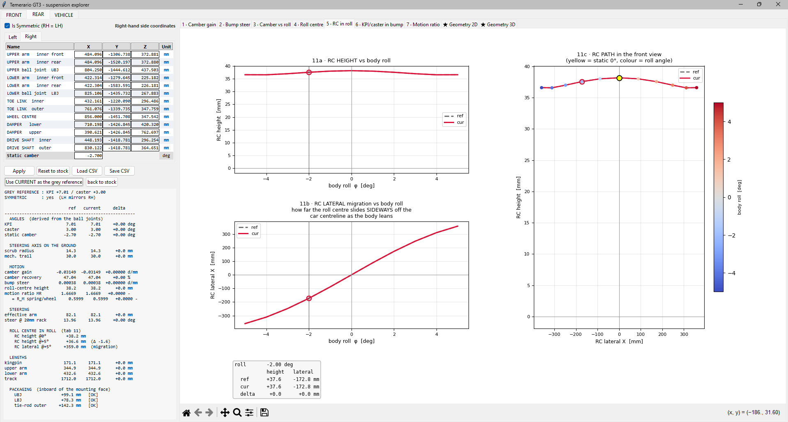

# Hard points

`../hardpoints_fusion.csv` is what the tool loads on startup. It is the starting
geometry, straight out of CAD, and the eight studies in `../studies/` were all
run against it.

`hardpoints_redesigned.csv` here is where that geometry ended up after working
the front axle and then the rear through the tool. Load it on the FRONT page,
then load it again on the REAR page. The file holds both corners and each page
picks out the rows it needs.

## What changed

Both columns below are printed by `verify_table.py` from the two CSV files, not
typed in. Run it to check them:

```bash
python hardpoints/verify_table.py
```

Front static camber −2.7°, rear −1.5°, both columns.

| | starting | redesigned |
|---|---|---|
| **front** | | |
| roll centre | −283.6 mm | **+30.8 mm** |
| bump steer | −0.1169 °/mm | **−0.0028 °/mm** |
| scrub radius | 144.9 mm | **17.3 mm** |
| mechanical trail | 31.1 mm | **30.2 mm** |
| KPI | −5.27 ° | **+7.64 °** |
| caster | +1.66 ° | **+7.99 °** |
| camber gain | −0.023 °/25 mm | **−0.694 °/25 mm** |
| Ackermann, straight ahead | +129.7 % | **+16.4 %** |
| RC lateral at 1° roll | −146 mm | **+50 mm** |
| arm ratio, lower/upper | 1.008 | **1.310** |
| **rear** | | |
| roll centre | −51.6 mm | **+38.0 mm** |
| bump steer | +0.0055 °/mm | **+0.0004 °/mm** |
| scrub radius | 138.4 mm | **7.1 mm** |
| mechanical trail | 52.5 mm | **30.0 mm** |
| KPI | −2.73 ° | **+7.01 °** |
| caster | +8.70 ° | **+3.00 °** |
| camber gain | −0.355 °/25 mm | **−0.787 °/25 mm** |
| camber recovery | 20.4 % | **47.0 %** |
| FVSA | 4290 mm | **1830 mm** |
| RC lateral at 1° roll | −847 mm | **+86 mm** |
| arm ratio, lower/upper | 0.847 | **1.240** |
| **dimensions** | | |
| wheelbase | 2645.0 mm | **2700.0 mm** |
| front track | 1662.4 mm | **1742.0 mm** |
| rear track | 1645.8 mm | **1712.0 mm** |

Three conventions have to be stated, because a before/after table is only
honest if both columns use the same one.

**Static camber is a setup input, not a hard point.** Scrub and roll-centre
height both move with it. Rear scrub moves 6.08 mm per degree of camber, so
quoting the two columns at different camber settings would invent most of a
change that was really a shim. One value per axle, used for both columns.

**Arm ratio** is the perpendicular distance from the ball joint to its inner
hinge *axis*, lower over upper. The arm swings about that axis, so that is the
radius that governs how fast the instant centre sweeps. The distance to a pivot
*point* is a different number and gives a different ratio.

**RC lateral** is how far sideways the roll centre has moved at one degree of
body roll, from the two-corner axle model. It is quoted as a position, not a
gradient, because the migration is not linear: the curve is steepest through
the origin, so a slope fitted across the roll range **understates** the first
degree, which is the only part a stiff GT car ever sees. See the plot further
down for the numbers.

## The line worth pointing at

The roll-centre migration row, but not for the reason the table makes it look.

The table's two columns differ by the *whole* redesign, so its 847 mm to 86 mm
is the net of every step: the roll centre came up out of the ground, KPI went
from −2.73° to +7.01°, caster and scrub moved. The step I would actually defend
is one of those, and the table cannot show it in isolation, so
`verify_lengthening.py` builds the geometry that sits between the two columns:

```bash
python hardpoints/verify_lengthening.py
```

It takes the starting hard points and changes **only** the arm radii, sliding
each wishbone's two inner pickups along the arm line until they match the
redesigned values. A ball joint traces a circle of radius `r` about its inner
hinge axis; translating the pickups along that radius moves the axis without
rotating it, so the joint does not move and its velocity direction, which is
perpendicular to both the axis and the radius, does not move either. Position
and first-order motion are frozen by construction. Only the curvature `1/r`
changes.

| rear axle, \|RC lateral\| at 1° of roll | |
|---|---|
| starting | 846.8 mm |
| starting, arms lengthened and nothing else | **28.2 mm** |
| full redesign | 86.1 mm |



The redesigned rear on the tool's RC-in-roll tab. The middle plot is the one
that matters: lateral movement against body roll, reaching +359 mm at the +5°
the axes are drawn to. A stiff GT car lives in the first degree or so of that,
which is why the table above quotes 1° rather than a gradient.

The shape is the reason. The curve is steepest through the origin and flattens
towards the extremes, so a straight line fitted across the whole roll range
**understates** the first degree, which is the only part the car ever uses. On
this axle the fitted gradient is 74.6 mm/° while the actual movement at 1° is
86.1 mm. On the starting geometry it is worse: 587 mm/° fitted against 847 mm
of real movement at 1°.

Lengthening alone is worth **30×**, which is more than the net figure in the
table. The later steps gave 57.9 mm of it back, in exchange for a roll centre
above ground. The front behaves the same way: 146.1 mm to 10.3 mm on the
lengthening alone, 49.8 mm after the rest of the redesign.

The script also prints what the step cost, which is the part worth checking.
KPI, caster, scrub and trail come out at **delta 0.000000000**. Roll-centre
height moves 0.0014 mm, camber gain 1.3 × 10⁻⁵ °/25 mm, bump steer
1.5 × 10⁻⁶ °/mm: solver noise, not design change. Migration is a second-order
property of the linkage, so it can be bought without spending anything
first-order. That is the whole finding, and it is the one thing here I had not
read anywhere first.

## A note on the static camber settings

The table above runs the rear at −1.5°, the value the redesigned set is
specified at. The rear studies in `../studies/` run at −2.7°, which is the
module default in `software/rear_geometry.py` and predates the decision to
specify the rear at −1.5°. That is why the study plot quotes 20.4 % recovery
with the roll centre 52.0 mm underground while this table says 20.4 % and
−51.6 mm: same geometry, same definitions, 1.2° apart on a setup input.

Camber recovery does not care, because it is set by the linkage. Roll-centre
height moves 0.4 mm over that range and scrub moves 6.08 mm per degree, which
is the one to watch: rear scrub reads 145.7 mm at −2.7° and 138.4 mm at −1.5°
on the same hard points.

## Known gap: the front tie rod

The front Ackermann in the redesigned column is **+16.4 %**, and it should not
be. Moving the tie-rod outer ball joint 20 mm inboard takes it to −5.6 % and
takes front bump steer from −0.0028 to −0.0006 °/mm, while scrub, trail, KPI,
caster and roll-centre height do not move at all. That step is free and it is
not in this file yet, because the tie rod was the last thing worked and the CSV
was exported before it.

It is flagged rather than quietly applied: these are CAD coordinates and they
should be changed in CAD and re-exported, not patched in a text file.

## Format

```
Corner,Point,X_mm,Y_mm,Z_mm
```

`X` lateral, positive outboard. `Y` longitudinal, positive forward. `Z`
vertical, positive up. Millimetres. Both files hold the right-hand corners; the
left side is their mirror. Lines starting with `#` are ignored, so a header
block like the one in `hardpoints_redesigned.csv` is safe to keep.

Saving from the tool writes the same format, so anything you save loads back.
