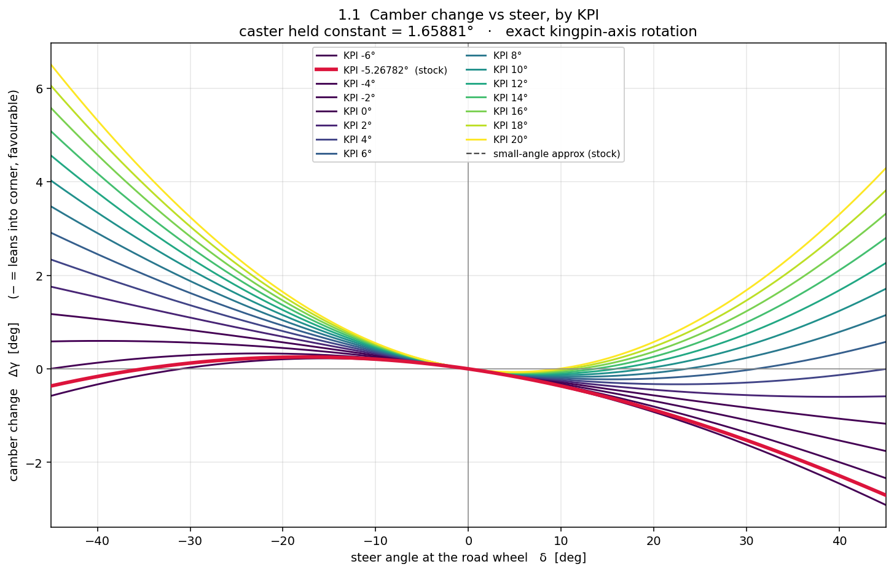
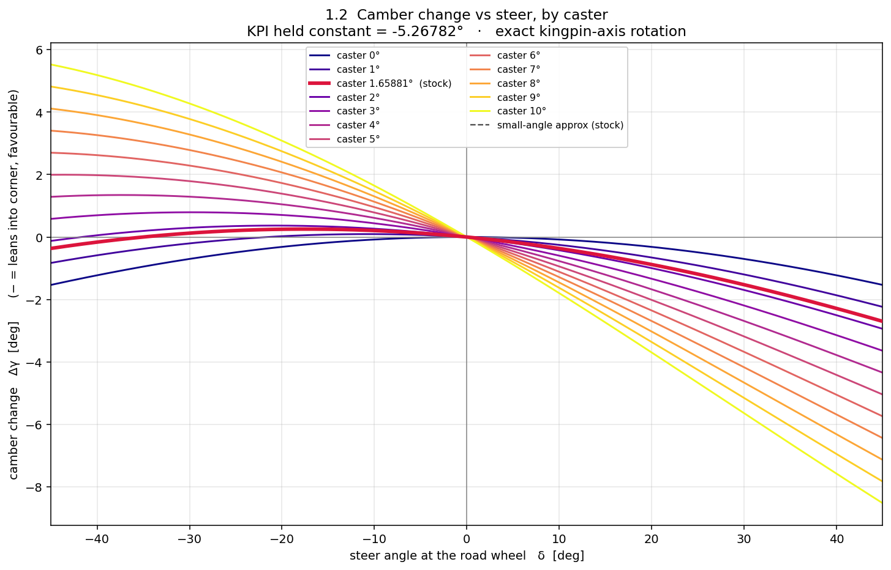
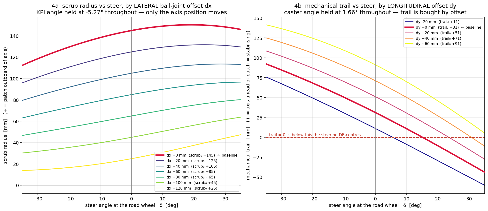
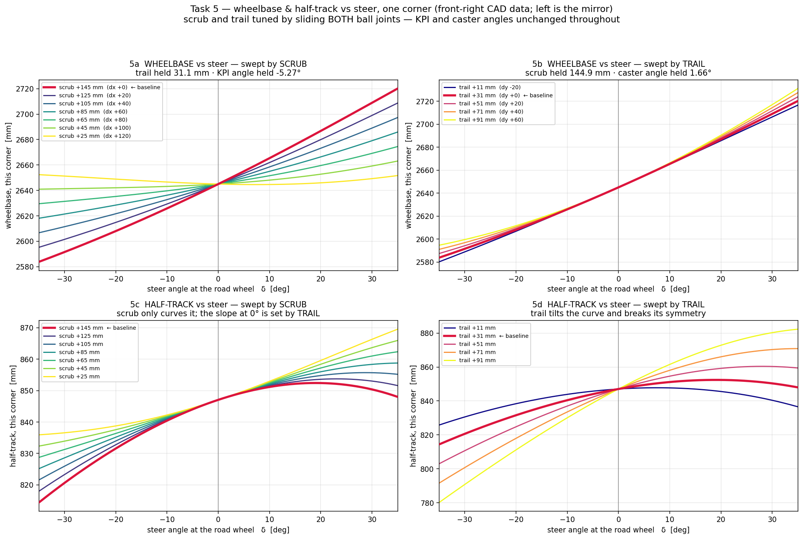
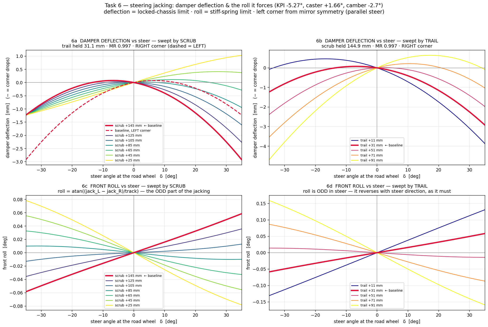
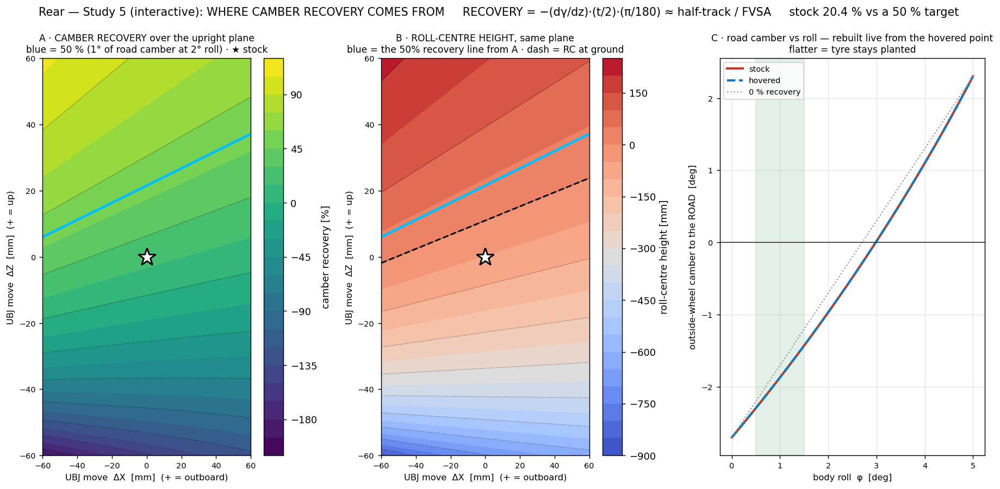
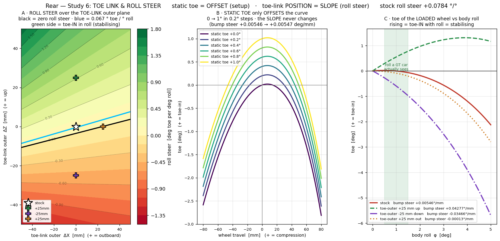

# Parameter studies

These eight scripts are not part of the tool. I wrote each one to answer a
question I had got stuck on, usually because I could not tell from a single
number whether a change was helping or just moving the problem somewhere else.
They sweep one parameter at a time and plot the whole family of curves, so the
shape of the dependence is visible rather than inferred.

They all run against the hard points in `hardpoints_fusion.csv`, the same file
the tool loads.

The rear ones run at **−2.7°** static camber, the module default in
`software/rear_geometry.py`. The comparison table in
[../hardpoints/README.md](../hardpoints/README.md) runs the rear at **−1.5°**,
because that is what the redesigned set is specified at, and the decision came
after these scripts were written. Camber is a setup input rather than a hard
point, so it shifts some readouts without changing the geometry: over that 1.2°
the rear roll centre moves 0.4 mm and rear scrub moves 7.3 mm. Camber recovery
does not move at all, because the linkage sets it. The note at the bottom of
that README has the numbers.

```bash
cd studies
python task1_1_camber_vs_kpi.py
```

Figures land in `plots/`. The three rear ones open an interactive window and
respond to the mouse; set `STUDY_NOSHOW=1` to just write the PNG and exit.

---

## 1.1 Camber change vs steer, one curve per KPI



I kept reading that KPI and caster both "give you camber when you steer" and I
wanted to see which one actually does the useful thing. This sweep holds caster
at the stock 1.66° and walks KPI from −6° to +20°.

The answer is in the symmetry. KPI's contribution is **even** in steer: the
camber change is the same sign whichever way you turn. So whatever it does for
the outside wheel, it does the opposite for the inside one. Useful for a road
car where you only care about the loaded wheel, less so when both ends are
working.

The stock geometry sits at −5.27°, the thick red line, which is the wrong side
of zero and barely does anything either way.

## 1.2 Camber change vs steer, one curve per caster



The same sweep with KPI frozen and caster walked from 0° to 10°.

Caster's contribution is **odd** in steer. Turn right and the right wheel gains
negative camber while the left loses it, which is exactly what you want: the
loaded outside wheel leans into the corner. At 8° of caster it is worth about 5°
of camber at 30° of lock.

Putting these two plots side by side is what made me stop treating KPI and
caster as interchangeable. Caster is the camber knob. KPI is mostly a packaging
and scrub consequence.

## 4 Scrub and trail vs steer, by ball-joint offset



This is the one that changed how I work. I had been trying to fix scrub by
changing the KPI angle, which drags camber-by-steer and the front-view swing arm
along with it.

Instead both panels slide the ball joints **along the steering axis** and leave
the angles alone. 4a holds KPI at −5.27° throughout and still walks scrub from
+145 mm down to +25 mm. 4b holds caster at 1.66° and walks trail from +11 to
+91 mm. The axis stays pointing where it was; only its position moves.

4b also showed me a problem I had not looked for. On the baseline, trail crosses
zero at about 15° of steer, and past that the steering de-centres instead of
self-centring. That is well inside the lock a hairpin uses.

## 5 Wheelbase and half-track vs steer



Steering a car with any scrub or trail moves the contact patch, so the wheelbase
and track are not constants. I wanted to know how much, because those two feed
straight into the load transfer calculation.

The split is clean. **Scrub curves the half-track; trail sets its slope through
zero.** At the baseline 145 mm of scrub the half-track turns over around 20° of
lock and starts coming back, which is why 5c bends. Drop scrub to 25 mm and it
goes nearly straight.

Wheelbase on this corner moves about 140 mm across the lock range, which was
more than I expected and is a good argument for not quoting a single wheelbase
number anywhere it matters.

## 6 Steering jacking



If steering moves the patch, it also has to move the car vertically. This one
asks how much, by holding the chassis and reading the damper deflection, then by
holding the springs and reading the roll it forces.

The numbers are small, about 3 mm of damper travel and under a tenth of a
degree of roll at full lock, but the sign is not arbitrary. The roll is odd in
steer, as it has to be, and it reverses when scrub crosses zero. Worth knowing
exists; not worth designing around on this car.

## Rear 5 Where camber recovery comes from


Camber recovery was the number I understood least. This maps it over the plane
the upper ball joint can move in, with the inboard pickups frozen.

The second panel is the point. Chasing recovery drags the roll centre with it:
the two contour sets run in the same direction, so you cannot ask for one
without getting the other. Starting geometry was 20.4 % recovery with the roll
centre 52.0 mm underground, both at the −2.7° rear camber this script runs at.
Getting recovery to a useful 50 % also lifts the roll centre to roughly +40 mm,
which happens to be where I wanted it, but that is luck, not design, and on a
different car the two would fight.

The lime line is 50 %. I picked it by asking the tyre to stay within 1° of its
static camber at 2° of body roll, which gives `φ(1 − r) ≤ 1°` at `φ = 2°`.

## Rear 5 again, the interactive version



Same maps, but hovering rebuilds the right-hand panel live for whatever point
the cursor is over. The static version tells you what the field looks like; this
one is what I actually used to pick a point, because you can feel the trade
instead of reading it off two colour bars.

## Rear 6 Toe link and roll steer



I had been confusing two things that live in the same units. The middle panel
settles it: static toe only **offsets** the toe-vs-travel curve. Six curves from
0 to 1° of static toe, all parallel, bump steer unchanged at +0.00546°/mm. The
slope is set by where the toe link sits, not by how you shim it.

So static toe is a trackside adjustment and the toe link is a design decision,
and a constant can never cancel a swing.

Panel A maps roll steer over the toe-link outer ball joint's plane. Green is
toe-in with roll, which is the stabilising direction. The blue contour is 0.067°
of toe per degree of roll, which comes from holding the toe change under 0.1°
across the 1.5° of body roll a stiff GT car actually reaches. Black is zero.
Either is defensible; what you do not want is the red side.

---

## A note on reference lines

Two of these plots used to carry a reference line I could not show the working
for. Both now come from a stated criterion instead: 50 % recovery from holding
road camber within 1° at 2° of body roll, and 0.067°/° roll steer from
holding toe change under 0.1° across the 1.5° a stiff GT car reaches. You can
argue with either criterion, which is the point. The reasoning sits in the
script header next to the constant.
